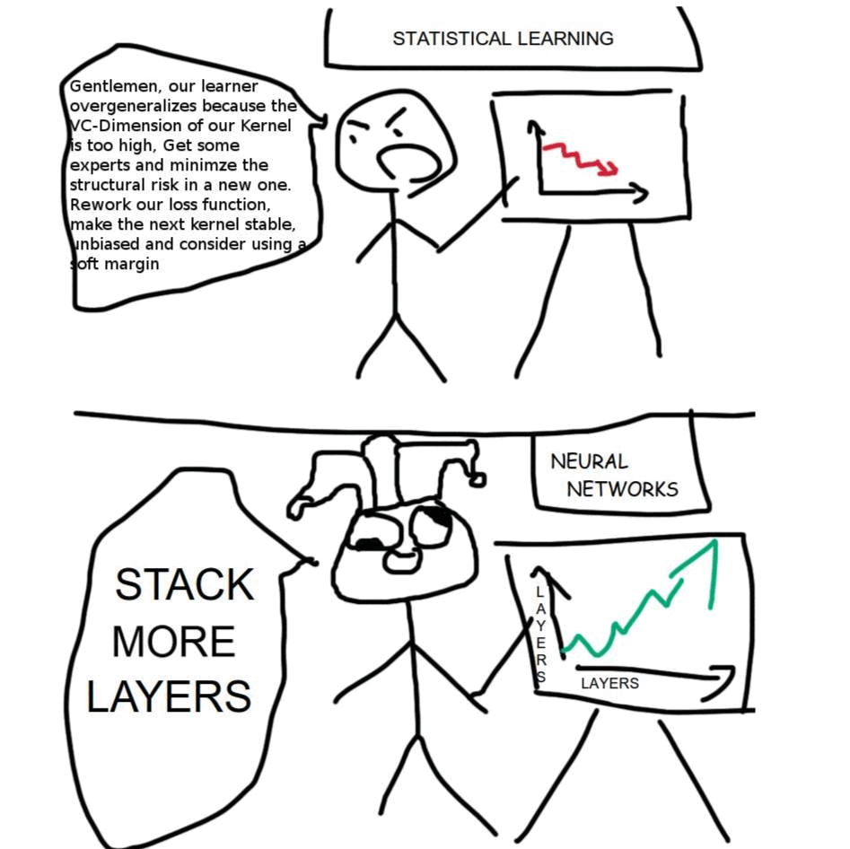
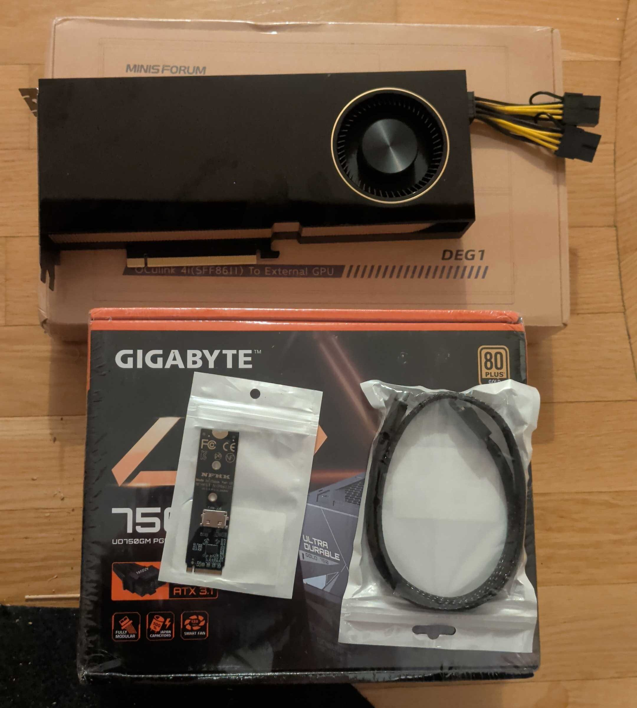
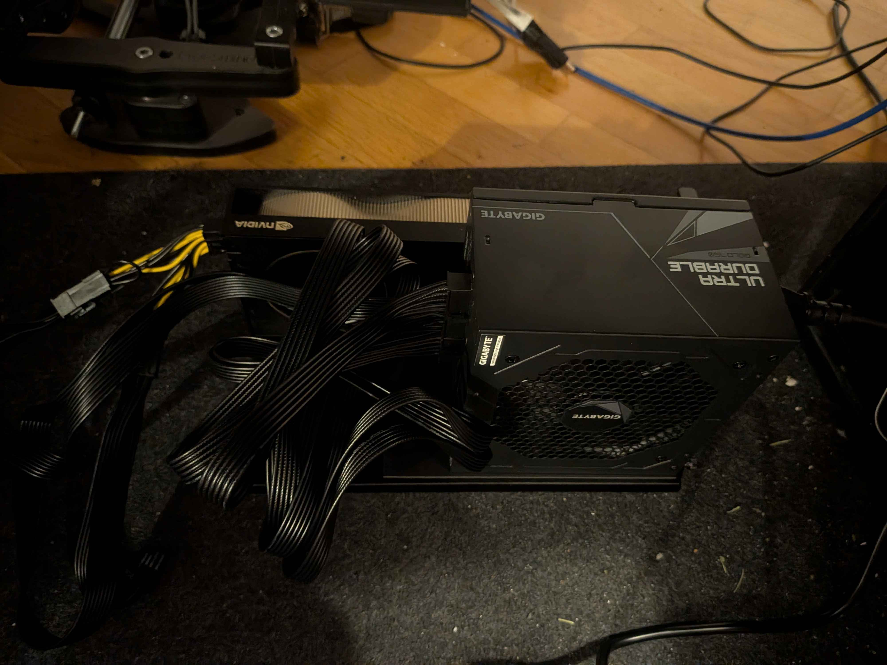
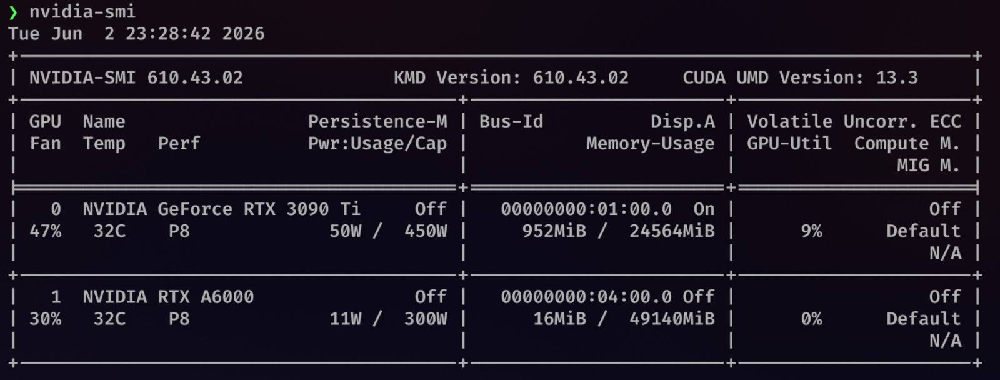

I like to play with technology, and since I already work(ed) on AI for my day job, I find it only natural to have the urge to play with local LLMs, too. This post is a short description of my local datacentre; while I planned to write this for a long time, [recent media news](https://www.pcmag.com/news/sam-altman-suggests-running-ai-locally-is-a-waste-of-memory) has greatly hastened the writing of this post. I sure hope this doesn't motivate one more person to run inference locally... or, to paraphrase the old TV shows, do try this at home, kids.

## Hardware side

Researchers figured out that there's a cheat code for LLM performance by simply scaling up: 

This helps performance (accuracy), but also hurts performance (output generation speed), requiring an ever-increasing amount of compute hardware. Eventually, it turned out that [my already beefy PC](https://pcpartpicker.com/b/ZjNPxr) with an RTX 3090 Ti couldn't keep up with the advancements in the field anymore. I needed[^1] something more.

My plan was to grab the maximum memory I could at the lowest price, without disregarding compute. While the plan was 99% inference, I also wanted to leave some room for running fine-tuning and training runs. This led me to find a good deal on an RTX A6000.

The problem, though, was how to connect it to my PC. One issue was the power supply, as my 850W was at its limit with the rest of the PC. A bigger issue was that there was simply no space in my case for another GPU next to the original one. To top that off, even if I could put it inside _physically_, there was no way for me to _utilise_ both of them due to my motherboard. I realised that, while I have two PCIe x16 slots, _only one of them_ — in my case, the one the 3090 Ti sits in — runs at x16. With both populated, the second slot is capped at x4. Silly me didn't expect I would ever want to have multiple GPUs when I was configuring my PC, I guess.[^2]

I was definitely not the first person with that problem, and as per the wonderful[^3] [egpu.io](https://egpu.io/) forum there are usually two solutions: PCIe risers, or a completely separate, external GPU setup. You'd never guess it, but I opted for the second option, largely for logistical reasons of the PC case, but also because I didn't want to buy a 2kW PSU to power everything together.

An eGPU setup consists of a GPU (hopefully obviously?), a PCIe dock, a separate PSU that powers it and a connector. I expected a long PCIe cable connector with parallel wires (apparently also called riser cables!) but these have drawbacks, the main one of which is signal degradation due to EM interference. That's why, among other reasons, OCuLink (Optical-Copper Link) exists. It's a cable that plugs into the board via an M.2-to-OCuLink adapter. Its drawback, though, is that it can only support x4, but as we saw earlier, that's not a constraint at all; it's actually pretty aligned with my motherboard.

One tiny detail: I was urged by various websites to buy an OCuLink adapter with a redriver (a PCIe signal repeater), as it allegedly helps with signal stability. I don't have hard data on it, but my experience so far is remarkably stable, performance-wise.

The instructions are simple:
* GPU -> dock
* PSU -> dock
* PSU -> GPU, with approximately 1204 cables 
* OCuLink -> dock
* redriver adapter -> OCuLink
* redriver adapter -> M.2 port on the motherboard
* and finally, a Schuko-to-C13 power cord -> PSU 😁

## Software

Having spicy silicon is not enough: you need to put it to use, otherwise you have an insanely expensive ~~paperweight~~ heater. I experimented a lot[^4], and this is what I found works best for me. Having said that, I'm open to suggestions! If you have a setup you think is nifty, let me know! Having said _that_, if you want to send me a procedurally generated message advertising your vibeslopped harness, I'll be closed for suggestions for the foreseeable future.

For model inference, I first started with LM Studio because it was easy to try out various models and start them all up, and there was a baked-in chat UI. I then switched to llama.cpp because I realised I was losing a few percent of performance, which I consider more important than the UI. LM Studio is itself built on llama.cpp under the hood, so I couldn't say exactly where the percent was going. I guess a heavy frontend just introduces work of its own. All I know is that ditching it for llama.cpp inference in Docker fixed it. I'm running a custom-built Docker image, with various improvements for my model of choice, Qwen 3.8 Flash Next. The improvements come from a handful of unmerged PRs on the llama.cpp repo 🙂 and were picked by Qwen 3.8 Flash Next itself. The exact build, patches and settings will end up published on my GitHub eventually.

Re: model of choice, there's [a whole other blog post](/posts/ode-to-qwen-3-8-flash-next) about it, but for now, I'm serving Unsloth weights with a Q3_XL quantisation. Turns out even this beefier setup can't run Q4, which is usually considered the best performance/resource ratio, but I honestly don't mind it in Q3. One important detail is that I don't use default chat templates; I use [custom ones](https://huggingface.co/peculiar-ragdoll/Qwen-Sharp-Chat-Templates) that appear to improve performance. That is both wild to be a thing to optimise (says I who does prompt optimisation for work) and that it measurably performs better.

## Harness

While I was exploring the expansive world of harnesses, my top constraint was for it to support local models. Turns out, back in the prehistory (June 2026), that significantly constrained the number of options. I settled on two: [omp](https://omp.sh/) as the main CLI interface and [Zed](https://zed.dev/) as the GUI. I picked Zed because I already wanted to try Zed and realised it's also neat as the AI entrypoint. I picked omp because I like how feature-packed it is (it's based on [Pi](https://pi.dev/) but with a bunch of batteries and lifesavers already included — I'm not a minimalist regarding the developer environment) and it's got 3000+ releases weekly (which I like! I don't have to wait for months for bugfixes and new features!), and it's very easy to write plugins for it.

## Future?

Local serving is both fun and incredibly useful, and I don't intend to stop, no matter what CEOs have to say. My next goals, in order, are:

### Set up Home Assistant integration

This step also requires step 0 "Set up Home Assistant in the first place". I am not sure what I can use it _for_ at the moment, but it seems fun to at least try setting up, for example, a household knowledge base.

### Swarms, perhaps?

Not to be the kitten depicted below, but one bad thing about serving Qwen 3.8 Flash Next across both of my GPUs is that... it uses both of my GPUs. Actually I had to offload some layers to RAM to keep my PC from misbehaving, like websites breaking or the app launcher menu not showing up, all due to insufficient memory. So recently I had an idea: what if I treated myself to a Strix Halo machine or an NVIDIA DGX Spark to run multiple LLMs in a swarm setting?

My partner, the household's shareholder, wants us to prioritise Food and Shelter, so she disagrees with that idea vehemently. Maybe we should do a session on OKR alignment. 

[^1]: *Need* is a strong word; perhaps *want* is a more suitable one 😁

[^2]: I feel there's a lesson here about future-proofing your PC build; too bad I'll never learn it.

[^3]: Wonderful for the most part; just as I was setting this up, they had a broken bot detection which limited my time there to like 3 requests.

[^4]: Just like in my youth.
