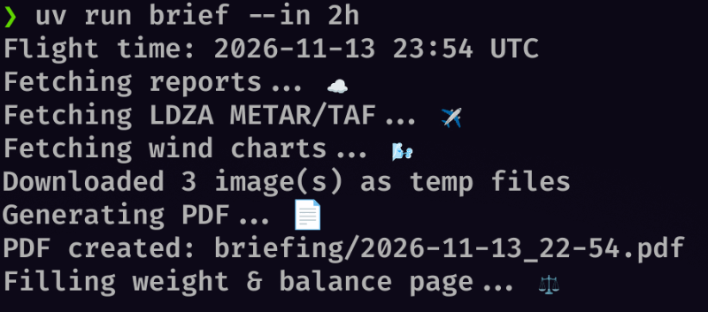

Qwen 4 is about to come out (maybe?? We don't know Qwhen exactly 😁) and since it's likely it'll replace my model of choice, Qwen 3.8 Flash Next (or QFN for short), I felt this was a good moment to shed some light on a model that changed everything for me.

You see, I started playing with local LLMs mostly out of curiosity. I didn't believe they could _actually_ be useful. I thought it would be an interesting gimmick, a language sampling tool that could be nice here and there, but that's about it. The true power would stay behind the paywalled gardens of the stereotypically greedy corporations. It turned out that the global _capability_-measuring contest accidentally created an incredible level of intelligence available to everyone[^1] at home. This is my recollection of all the projects I did with it.

## Pre-QFN

I played with various open models. I don't remember most of them as there was plenty of garbage, but for example I do remember Gemma 4 + Qwen 3.6 as a particularly nice combination: Gemma in the role of a planner and Qwen in the role of a coder. I actually still use Gemma 4 now and then because it's super great for general factual knowledge and math. But one day I saw QFN announced with a tagline that it was a preview of Qwen 4's future architecture, so I decided to try it out!

## QFN

There was something immediately different about QFN and the way it replies. Gemma's replies read just like what you'd expect from an LLM, with all their language quirks. QFN was different from the start, with a lot of _natural_-ish sounding sentences. Plus it didn't try to suck up to me all the time, which I find annoying.

My usual first test for a new LLM is three rather simple Python projects (two are CLIs, and the third is a web server[^2]), in which I first let the models do whatever they want in the first iterations (benchmarking functionality only), and then I introduce my constraints (such as using particular packages I prefer or adding new use cases) in a follow-up. Before QFN, Claude, for example, had no problem with it, but other local LLMs would routinely struggle.

Not QFN! For example, it rewrote the whole Python CLI script from `argparse` to `typer` in no time and, what slightly surprised me, in a similar style to what I would write. I'm not the best coder who has ever existed (likely?) but like, the variable names were okay, code flow was readable, it even introduced me to some of the newer typer features I didn't realise had been released. I mean, those features are likely in the training set by now, but I still found it interesting how much of an improvement QFN was in comparison to other models that existed!

## Router debugging

Just like [Leslie in Parks and Recreation](https://www.youtube.com/watch?v=LinpRhB4aWU), I also had network connectivity problems at one point. Due to their intermittent, unpredictable nature, they were debilitating. I couldn't work from home, I couldn't doomscroll, and the worst was, my partner couldn't do her biweekly WoW Classic raid sessions :). I was ready to yell at the ISP, but figured I could ask an LLM myself first because, well, I kind of expected an LLM response from the ISP anyways. Now you see, using LLMs via LLM providers requires a working internet connection, but you know what doesn't? _Local LLM inference_. So I gave QFN the opportunity to prove itself, and it absolutely slapped.

First it poked around my network setup, realised what router I ~~own~~ rent from the ISP, and then it figured out/hacked around its telemetry settings. Then it created a sampling script and... waited in the background. From the histogram of the bad events across frequency channels it realised most of them were in the low frequency range, which implied that the error was within my walls rather than at the ISP. After a day of back and forth, debugging and probing everything, it came down to my coax cable, or more concretely, its connection to the wall socket. I keep my router in a cupboard within a wall shelf, and the socket is rather difficult to reach. It was all rusty and basically fell out of the wall. Once I retightened it and connected it, it worked flawlessly. It still does.

## RSI[^3] I mentioned

For my next set of challenges, I gave QFN the chance to **optimise itself** (at least [the serving part](/posts/my-e-gpu-rig), not [the weight part](https://rikiyat.github.io/blog/weight-space-programming/)). I serve QFN as the [`UD-Q3_K_XL` quantisation](https://huggingface.co/unsloth/Qwen3.8-Flash-Next-GGUF) on [My eGPU rig](/posts/my-e-gpu-rig), and the question was can it do better than I at configuring the serving system.
First I pointed it to my llama.cpp `docker-compose.yaml` to patch up MTP[^4] support for QFN, which had come out relatively recently. MTP was not supported at that time and [a PR had been opened for it](https://github.com/ggml-org/llama.cpp/pull/28243) (I'm still salty it was closed without merging, because it performed faster than what **was** merged) so I made QFN recompile and patch llama.cpp. And it did ‼️ It then introduced some simplifying assumptions to the repo for my setup (like targeting only `sm_86` GPUs) which gave me about a 20% performance boost. QFN also, completely unprompted, suggested what else could be improved, and after about 20 minutes of measuring my systems and testing payloads it found a set of settings that improved prefill and decode speed by about another 20%. In the end I went from about 800 to 1200 tok/s prefill and from about 45 to 60 tok/s on decode; the exact llama-server flags, patches and settings will end up published on my GitHub eventually. The gains were pretty substantial, which surprised me, because I thought llama.cpp was already a pretty well-optimised runtime, and moreover a bunch of PRs are LLM-generated anyways so it's weird _they_ missed it. This speedup further unlocked other stuff like...

## PPL help

I built a series of projects to help me with my [Private Pilot's Licence](/posts/learning-to-fly-through-windows-in-cloud) (PPL) that I finished this year:

### Weather Briefer

While I was studying to become a pilot, I developed a manual routine for fetching cloud coverage maps, winds, and METAR/TAF. I automated that with an intentionally vague prompt to test the capabilities. I simply described what I needed and asked for a Python script that would print (as in, physically print) everything for me. QFN then went on to reverse-engineer Croatia Control's undocumented web endpoints to fetch relevant images and parse METARs/TAFs, writing all materials into a PDF and then sending a network request to my LAN printer. My pre-flight briefing went from 10 minutes to 10 seconds. 

### Weight & Balance

Then as part 2, I automated populating my weight and balance sheet. Before every flight, the pilot needs to know how heavy the airplane is and where the centre of mass is. There's usually a PDF template with a table and 3 graphs that we fill in manually. I gave QFN the W&B PDF template and, again, intentionally vague instructions: "make a Python script that fills that in for me". What followed was a 4-hour crunching spree of retrieving the images of the 3 charts in the template, interpreting the lines by _calculating image histograms_, calculating _the equations of the boundaries_ on the graphs, inventing a _global coordinate system_ and 3 graph-relative local coordinate systems. The whole time _it tested itself_ by rendering the document, taking screenshots and recognising what's wrong. I compared the outputs with what I did manually and it matched 100%. The script first correctly calculates the values (position of the centre of mass and the moment), from those it calculates the X-Y coordinates of the values on the graph, and then it maps those coordinates to the global coordinate system of the whole PDF document, resulting in a transparent overlay over a template. I was stunned by the amount of independence. It had to compact its context like 6 times, but it still did it correctly anyways.

![A sneak peek of what's necessary for an average 40-minute route flight over my country. You can see, in order: the navigation log (90% machine generated), a physical map with a route drawn in (completely manually), my Weight & Balance sheet correctly filled in, wind chart from the weather briefing, and at last a Weather Briefing 1-pager with METAR and TAF additionally added in. I used to have to do 100% of this by hand, which was very toil-y. Bonus points: I found a 4-leaf clover one day 🍀 and have since been carrying it around with me.](PXL_20261112_191931699_2.jpg)

### Route briefings

I automated my route briefings, too. It made me a slicer script that takes Croatia's (and Slovenia's) VFR chart; I tell it which region I want, and I get out an A4 slice of the map at a proper 1:500,000 scale, which allows me to use actual pre-made rulers and measure distances and angles like on the real map.

### Route briefing web UI

Finally, it made me a nice web UI to speed up my route briefings. I only select the waypoints and it calculates distances and azimuths automatically. If I enter the expected wind, I can also get wind correction angles, headings, ground speed and timings. Then it can also populate yet another PDF template, this time the navigation log, with all the route legs and with all the necessary information, in the way the info is supposed to be formatted, like red bold headings.

I didn't start with these scripts, I did things manually for a long time before thinking I could probably test QFN on the automation task without spending any effort of my own. And it performed incredibly well.

**Honourable mentions**: a project to teach me to write a compiler/formatter for my own flavour of YAML, a rewrite of a card game engine from my uni days, which taught me the actor pattern, a plugin for [OMP](https://omp.sh/), my agentic CLI harness, to orchestrate a subagent swarm, an FPGA ternary computing exploration project, and finally I'm wiring up fourteen 18650 cells to form a 24V battery — the usual life stuff from a tech nerd, all powered by a locally available intelligence. I might open-source some of these, but I kinda feel open-sourcing has lost its purpose. But that's a talk for another post.

## Verdict

I now have complete trust that QFN can do just about every project I can think of. I was curious at first; it grabbed my attention quickly and now I'm literally daily driving it. My usage patterns have now shifted from coding to general usefulness: the other day I gave QFN 20 pictures of documents I had to send to the Croatian Civil Aviation Agency for my PPL licence. It read every image and figured out how to group them ("these ones are national ID, these ones are an exam report" etc). It also recognised **on its own** that some of the images were distorted by perspective, so it wrote a tiny Python script to fix the distortions (again, on its own ‼️ it showed better taste than me) and then it wrote 5 PDF files with those images. In another instance, I told it to do a filesystem sweep and figure out how to release some storage space; long story short I now have 400 GB extra space from unnecessary files that were hogging my PC, some of which were older than my PC (files carried over from older laptops and PCs — not backup archives, just loose transfers).

My position is somewhat privileged. But I feel QFN didn't get as much love on the internets as it deserved, probably because its resource requirements keep it off most people's shortlist. I honestly think it's about Opus 5 level, perhaps slightly worse. In my few months of testing it, I never found a task it couldn't do; never. I am pretty confident it can perform any task that Opus 5 can, but it will perhaps struggle a bit more, take more tries and time. But it will probably do it, eventually. It also barely seems to hallucinate; I can't remember it ever stating something confidently wrong, a behaviour I saw in, for example, Gemma. QFN always defaults to either questioning or self-doubt and likes to double and triple check everything that was in the prompt and the tool call output. It also avoided other LLM failure modes, like mode collapse — repeating words and spewing nonsense. 

Not everything is perfect. 60 tok/s is still at the slow end, and the model is _really_ an overthinker. After weeks of trying (by myself, too!) I just couldn't find a **reliable** setting for the thinking effort levels, either through llama.cpp settings or the [OMP](https://omp.sh/)/[Zed](https://zed.dev/) effort level chat settings. It seems that it just innately likes to think extensively. But to have _this_ level of intelligence and capability, under my desk for free? With widely available weights out in the open? For a mere operating cost of the monthly electricity bill? That is, by Gods, the future I was promised in sci-fi.

Thank you, Qwen 3.8 Flash Next, may your descendants be ever more intelligent, and ever cheaper.

[^1]: That's not really true; I'm actually very privileged to be able to host and run LLMs locally. The barrier to entry is significantly higher than, say, the FOSS movement which requires a laptop and (optionally) internet. It's perhaps more similar to the computing movement of the 1970s, so I hope we get to see a Cambrian explosion of cheap local inference hardware.

[^2]: I won't get into specifics lest the benchmarks get benchmaxxed.

[^3]: Stands for Recursive Self Improvement. I have not put an LLM through a repetitive strain injury. Yet.

[^4]: Stands for Multi-Token Prediction. The model has extra output heads that guess several upcoming tokens in a single forward pass, and the main model verifies them in one go. Speeds up decode.
